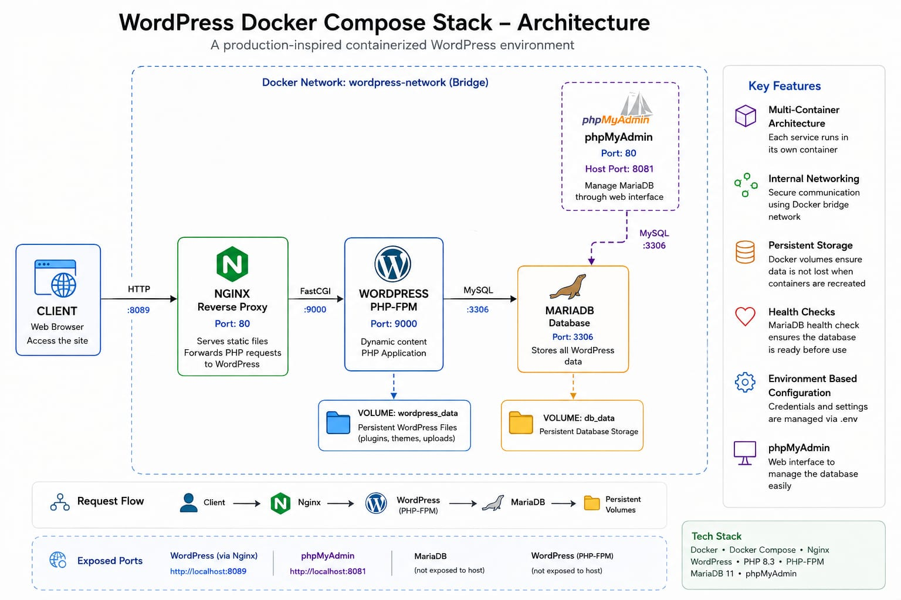

# 🐳 WordPress Docker Compose Stack

A learning project for a containerized WordPress deployment built with Docker Compose, Nginx, PHP-FPM, MariaDB, and optional phpMyAdmin. It is not a production deployment template.

The project demonstrates how multiple services can be orchestrated together using Docker Compose while maintaining service isolation, persistent storage, internal networking, health checks, and environment-based configuration.

---

## 🏗️ Architecture

                         ┌─────────────────────┐
                         │       CLIENT        │
                         │   Web Browser / API │
                         └──────────┬──────────┘
                                    │
                              HTTP :8089
                                    │
                                    ▼
                         ┌─────────────────────┐
                         │        NGINX        │
                         │   Reverse Proxy     │
                         │      Port 80        │
                         └──────────┬──────────┘
                                    │
                               FastCGI
                                    │
                                    ▼
                         ┌─────────────────────┐
                         │      WORDPRESS      │
                         │    PHP-FPM 8.3      │
                         │      Port 9000      │
                         └──────────┬──────────┘
                                    │
                              MySQL Protocol
                                    │
                                    ▼
                         ┌─────────────────────┐
                         │       MARIADB       │
                         │      Port 3306       │
                         │     Primary DB       │
                         └──────────┬──────────┘
                                    │
                                    ▼
                         ┌─────────────────────┐
                         │      DB VOLUME      │
                         │      db_data        │
                         │   Persistent Data   │
                         └─────────────────────┘


             ┌───────────────────────────────┐
             │          PHPMYADMIN           │
             │             :80               │
             │         Host :8081            │
             └───────────────┬───────────────┘
                             │
                             ▼
                          MariaDB

Request Flow

Client
  │
  ▼
Nginx :8089
  │
  ▼
WordPress / PHP-FPM :9000
  │
  ▼
MariaDB :3306
  │
  ▼
Persistent Docker Volume


---

🚀 Project Overview

This project provides a complete containerized WordPress environment using a multi-service Docker Compose architecture.

The stack separates each major component into its own container:

Nginx — Reverse proxy and HTTP entry point

WordPress — Application layer running on PHP-FPM

MariaDB — Relational database

phpMyAdmin — Web-based database administration

Docker Volumes — Persistent application and database storage

Docker Network — Private communication between services


The goal of the project is to demonstrate practical DevOps concepts rather than simply running WordPress in a single container.


---

🛠️ Technology Stack

Technology	Purpose

Docker	Containerization
Docker Compose	Multi-container orchestration
Nginx	Reverse proxy
WordPress	Web application
PHP 8.3	Application runtime
PHP-FPM	PHP process manager
MariaDB 11	Relational database
phpMyAdmin	Database management
Docker Volumes	Persistent storage
Docker Networks	Internal service communication
Bash	Container and system automation


---

✨ Key Features

🐳 Multi-Container Architecture

The application is divided into independent services managed through Docker Compose.

🌐 Nginx Reverse Proxy

Nginx acts as the public entry point and forwards PHP requests to the WordPress PHP-FPM container.

🗄️ MariaDB Database

MariaDB provides the persistent relational database required by WordPress.

💾 Persistent Storage

Docker named volumes are used to prevent data loss when containers are recreated.

❤️ Health Checks

MariaDB includes a Docker health check to verify that the database is ready before dependent services start.

🔗 Internal Docker Networking

All application services communicate through a dedicated Docker bridge network using Docker Compose service discovery.

Example:

wordpress → mariadb:3306

🔐 Environment-Based Configuration

Database credentials and environment-specific configuration are stored outside the Docker Compose file using .env.

🖥️ phpMyAdmin

phpMyAdmin provides a convenient interface for inspecting and managing the MariaDB database.

It is disabled by default. Start it only when needed with `docker compose --profile tools up -d phpmyadmin`; when enabled, it binds to localhost only.


---

📁 Project Structure

docker-compose-wordpress-stack/
│
├── docker-compose.yaml
├── .env.example
├── .gitignore
├── README.md
│
├── nginx/
│   ├── Dockerfile
│   └── default.conf
│
├── wordpress/
│   ├── Dockerfile
│   └── php.ini
│
└── uploads/
    └── .gitkeep


---

⚙️ Environment Configuration

The project uses environment variables for sensitive configuration.

Create your local .env file from the example:

cp .env.example .env

Then configure the required values:

MYSQL_DATABASE=wordpress
MYSQL_USER=wpuser
MYSQL_PASSWORD=change_me
MYSQL_ROOT_PASSWORD=change_me_root
TZ=Africa/Cairo

> Security: Never commit the real .env file to GitHub.


The repository only contains .env.example with placeholder values.

Previously committed credentials may remain visible in Git history. Rotate any credentials that were ever used; replacing them in the current files does not revoke or erase historical values.


---

🚀 Getting Started

Prerequisites

Make sure the following are installed:

Docker

Docker Compose

Git


Verify the installation:

docker --version
docker compose version
git --version


---

1️⃣ Clone the Repository

git clone https://github.com/mhmdhmdbdh2050/docker-compose-wordpress-stack.git

Navigate into the project:

cd docker-compose-wordpress-stack


---

2️⃣ Configure Environment Variables

Create the .env file:

cp .env.example .env

Update the credentials according to your environment.


---

3️⃣ Validate the Compose Configuration

Before starting the application, validate the Docker Compose configuration:

docker compose config

This command verifies the Compose file and environment variable interpolation.


---

4️⃣ Build and Start the Stack

docker compose up -d --build

Docker Compose will:

1. Create the Docker network


2. Build the custom Nginx image


3. Build the custom WordPress PHP-FPM image


4. Pull MariaDB


5. Pull phpMyAdmin only if the optional `tools` profile is enabled


6. Create persistent volumes


7. Start the services


8. Perform the MariaDB health check


---

5️⃣ Check Container Status

docker compose ps

Expected services:

mariadb
wordpress
nginx

phpMyAdmin is not started by default. Start it separately with the `tools` profile when needed.

MariaDB should report:

Healthy

After Nginx starts, it should also report `healthy` once it can serve the WordPress endpoint.


---

🌐 Access the Application

WordPress

Open:

http://localhost:8089

phpMyAdmin is optional. Start it when needed:

```bash
docker compose --profile tools up -d phpmyadmin
```

Then open:

http://localhost:8081


---

🔌 Service Ports

Service	Internal Port	Host Port

Nginx	80	8089
WordPress PHP-FPM	9000	Internal only
MariaDB	3306	Internal only
phpMyAdmin (optional `tools` profile)	80	127.0.0.1:8081


Nginx is the only service exposed by default. phpMyAdmin is available only with the `tools` profile and binds to localhost.

MariaDB and PHP-FPM remain accessible through the internal Docker network.


---

🌐 Docker Networking

The project uses a dedicated bridge network:

wordpress-network

Services communicate using their Compose service names rather than hard-coded IP addresses.

For example:

WordPress → mariadb:3306
Nginx → wordpress:9000
phpMyAdmin → mariadb:3306

This approach provides service discovery and avoids dependency on container IP addresses.


---

💾 Persistent Storage

The stack uses Docker named volumes:

MariaDB

db_data

Stores the MariaDB database files.

WordPress

wordpress_data

Stores WordPress application files.

Persistent volumes allow data to survive container recreation.


---

❤️ Health Checks

MariaDB uses a Docker health check to verify that the database is available and initialized. Nginx checks its local HTTP endpoint so `docker compose ps` also reports whether the public entry point is responding.

Example:

healthcheck:
  test:
    [
      "CMD",
      "healthcheck.sh",
      "--connect",
      "--innodb_initialized"
    ]
  interval: 10s
  timeout: 5s
  retries: 5
  start_period: 30s

This helps prevent dependent services from attempting database connections before MariaDB is ready.


---

🔧 Useful Docker Commands

Start the application

docker compose up -d

Rebuild images

docker compose up -d --build

Stop containers

docker compose down

View running services

docker compose ps

View all logs

docker compose logs

Follow logs

docker compose logs -f

View WordPress logs

docker compose logs wordpress

View MariaDB logs

docker compose logs mariadb

Restart a service

docker compose restart wordpress


---

🧹 Cleanup

To stop and remove containers:

docker compose down

To remove containers, networks, and persistent volumes:

docker compose down -v

> ⚠️ Removing volumes permanently deletes the stored MariaDB and WordPress data.


---

🔐 Security Considerations

This project follows several basic security practices:

Credentials are stored in .env

.env is excluded using .gitignore

.env.example contains only placeholder credentials

Database ports are not exposed directly to the host

PHP-FPM is accessible only through the internal Docker network

Nginx acts as the public-facing entry point


For production environments, additional security controls would be required, including:

HTTPS/TLS

Secrets management

Firewall rules

Network segmentation

Container security scanning

Image vulnerability scanning

Resource limits

Centralized logging

Monitoring and alerting


---

🧪 Troubleshooting

Check service status

docker compose ps

Check MariaDB logs

docker compose logs mariadb

Check WordPress logs

docker compose logs wordpress

Validate Compose configuration

docker compose config

Check Docker networks

docker network ls

Inspect the project network

docker network inspect wordpress-compose-project_wordpress-network


---

🎯 Learning Objectives

This project was created to gain hands-on experience with:

Docker containerization

Docker Compose

Multi-container application architecture

Nginx reverse proxy configuration

PHP-FPM

WordPress deployment

MariaDB

Docker networking

Service discovery

Persistent volumes

Health checks

Environment variables

Container troubleshooting

Application deployment workflows


---

🔮 Future Improvements

Potential improvements for future versions include:

[ ] HTTPS with Let's Encrypt

[ ] Automated database backups

[ ] CI/CD pipeline with GitHub Actions

[ ] Container vulnerability scanning

[ ] Resource limits and health monitoring

[ ] Centralized logging

[ ] Prometheus and Grafana monitoring

[ ] Production-grade secrets management

[ ] Automated deployment to AWS


---

📸 Architecture Diagram

An architecture diagram illustrating the complete request flow and service relationships is included in the repository.


---

👨‍💻 Author

Mohamed Ahmed Abdo
